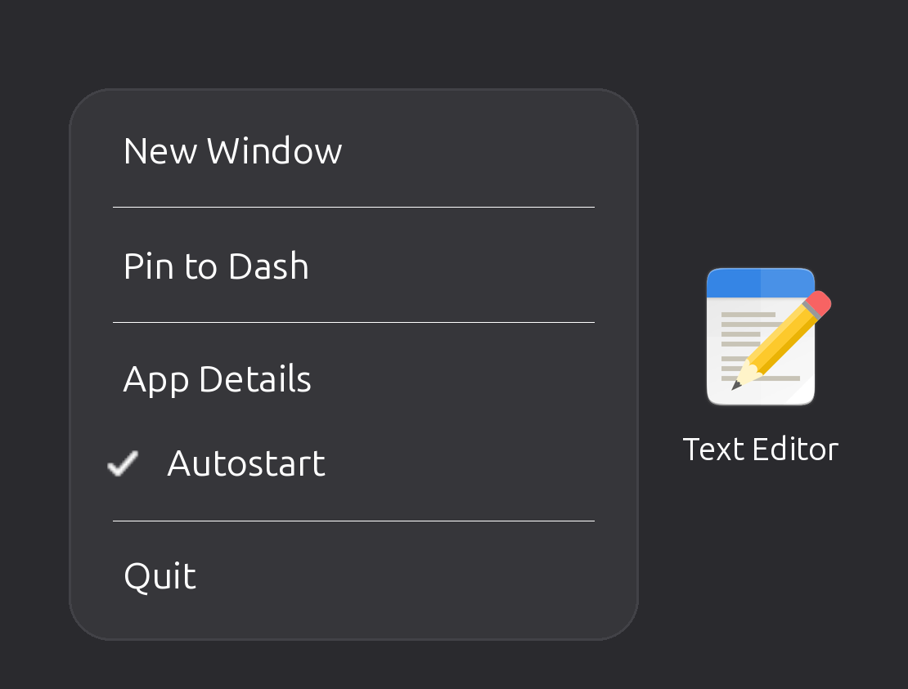

# Autostart Entry

Want an app to open when you log in? Right-click it and choose **Autostart**.

A check mark means that app starts with your computer. Click **Autostart** again to turn it off.

## Install

1. Install Autostart Entry from the [GNOME Extensions website](https://extensions.gnome.org/).
2. Turn it on.
3. Log out and back in.
